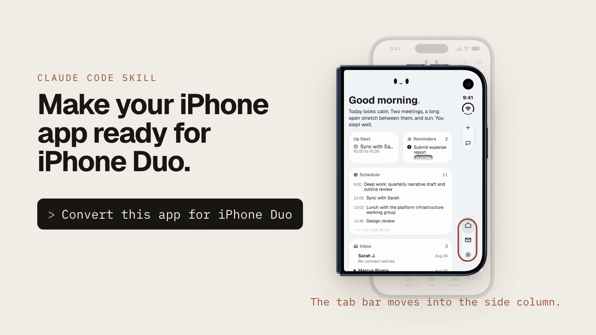

<p align="center">
  <h1 align="center">iPhone Duo Skill</h1>
  <p align="center">
    <strong>Get an iPhone app ready for the cover screen, the inner screen and the fold.</strong>
  </p>
  <p align="center">
    <a href="https://github.com/JustinPerea/iphone-duo-skill/blob/main/LICENSE"></a>
    
    <a href="https://claude.com/claude-code"></a>
  </p>
  <p align="center">
    <a href="#quick-start">Quick Start</a> &nbsp;&bull;&nbsp;
    <a href="#whats-inside">What's Inside</a> &nbsp;&bull;&nbsp;
    <a href="#how-it-works">How It Works</a> &nbsp;&bull;&nbsp;
    <a href="#limits">Limits</a>
  </p>
</p>

<p align="center">
  <a href="https://justinperea.com/lab/iphone-duo-skill"></a>
  <br>
  <sub>Watch the 31-second launch video</sub>
</p>

---

A [Claude Code](https://claude.com/claude-code) skill that converts, audits and tests an iPhone app for iPhone Duo. It reads your project and finds the code that breaks on a foldable: `UIScreen.main`, iPad-style size-class branches, hand-built bars, and layouts that swap containers and lose state on a fold. It fixes them in a set order, then has you check each changed screen in six simulator poses. Posing needs Device Hub on a Mac.

It covers SwiftUI, UIKit and storyboard apps, and has notes for React Native, Flutter, Unity, games, web views and other cross-platform stacks. So far it has been run end to end on one shipping SwiftUI app. The other app types come from Apple's guidance and have not been tried on a real app of each kind.

## Quick Start

**Requires:**
- [Claude Code](https://claude.com/claude-code)
- A Mac with Xcode 27.1, for the iPhone Duo simulator, Device Hub and the iOS 27.1 SDK. Xcode 27.0 cannot compile the Duo APIs.

**1.** Install the skill:

```bash
git clone https://github.com/JustinPerea/iphone-duo-skill ~/.claude/skills/iphone-duo-converter
```

The folder name has to be `iphone-duo-converter`, the name in the skill's frontmatter.

Start a new Claude Code session so it picks up the skill.

**2.** Open your app's folder in Claude Code and ask for what you need:

```
Convert this app for iPhone Duo
```
```
Audit my app for iPhone Duo and list what breaks
```
```
Run the fresh-app test plan on this project
```
```
Prepare my iPhone Duo App Store screenshots
```

## What's Inside

```
iphone-duo-converter/
├── SKILL.md                         # Quick audit, archetype routing, conversion playbook, 15 traps, verification, release
└── references/
    ├── apple-guidance.md            # Apple's HIG, docs, six tech talks, four group labs and store pages, sourced
    ├── edge-cases.md                # 118 edge cases, each with case, breaks, detect, fix, verify, source
    ├── verification.md              # Simulator, Device Hub, captures, UI tests, CI and device checks
    ├── fresh-app-test-plan.md       # Step-by-step trial on an unfamiliar app, with a results template
    └── mitamaton-case-study.md      # Worked example: what broke in a shipping SwiftUI app, and the fixes
```

Edge cases by area:

| Area | Count | Examples |
|---|---|---|
| Lifecycle and scenes | 16 | Missing UIScene lifecycle, `UIScreen.main`, two app instances, scene phase |
| Layout | 14 | Regular width is not iPad, screen-size buckets, paywalls held tall, book-pose readers |
| Bars and chrome | 11 | Side-column placement, empty `safeAreaBar`, bottom rows under the column, toasts |
| Presentation and in-tree panes | 11 | Detail beside list, `dismiss()` that does nothing, panels across a fold |
| Input | 5 | Keyboard frames, accessory bars, focus and drafts through a fold, drag and drop |
| Accessibility | 6 | VoiceOver across the fold, Dynamic Type caps, Voice Control on column items |
| Archetypes | 12 | Games, Metal, video, camera, web views, cross-platform hosts, maps |
| Testing | 27 | The Duo-only 27.1 runtime, fold tests that pass by accident, render tests |
| Store and release | 16 | SDK gate, screenshot sizes, alpha channels, the Duo display type, featuring |

## How It Works

1. **Quick audit.** An inventory of every target and language, then a set of greps over first-party and vendored code. Each hit maps to an edge case.
2. **Playbook.** Fixes in order of impact: lifecycle and toolchain, `UIScreen.main`, system bars, measured chrome, reading the fold, using the second half, presentations that survive a fold, scroll edges, text and accessibility, keyboard and scenes, cameras.
3. **Pose matrix.** Every changed screen in six poses (closed, partly open, open, each upright and turned), fold and unfold mid-task, plus Split View, RTL, accessibility settings and a control run on a plain iPhone.

`SKILL.md` stays short and loads the reference files only when a step needs them.

## Sources

Apple facts carry a source key, defined in the table at the end of `references/apple-guidance.md`. Findings from the worked example are labeled as such. The sources:

- Apple's Human Interface Guidelines page for iPhone Duo
- Apple's developer documentation and the "Preparing your app for iPhone Duo" article
- Apple's Prepare for iPhone Duo page
- Apple's six iPhone Duo tech talks
- Apple's four iPhone Duo group lab videos (September and October 2026)
- App Store Connect help pages and the App Review Guidelines

Group-lab answers are Apple engineers speaking live. The skill treats them as strong hints, not contracts. Anything marked **(unverified)** has not been confirmed by Apple or measured on a Duo. Code marked **(not compile-verified)** should be built before you trust it.

## Limits

- No API sets the hinge or rotates the Duo simulator. Poses come from Device Hub's controls, so fold tests need a Mac with a GUI, not hosted CI.
- Built and checked against Xcode 27.1 and the iOS 27.1 SDK in October 2026. Apple may change APIs, simulator behaviour and App Store rules. Recheck anything version-specific.
- Simulator measurements are not hardware measurements. Camera, sensors and ergonomics need a physical iPhone Duo.
- Written before iPhone Duo went on sale (October 23, 2026).
- The worked example is one SwiftUI app. Expect gaps on other stacks, and please report them.

## Contributing

Found an edge case that is missing, or a fix that no longer works? [Open an issue](https://github.com/JustinPerea/iphone-duo-skill/issues) with the pose, the app type and a source if you have one. `references/fresh-app-test-plan.md` ends with a results template; its "Skill feedback" section is the most useful thing to send.

## License

MIT. See [LICENSE](LICENSE).

Not affiliated with Apple. iPhone is a trademark of Apple Inc.
